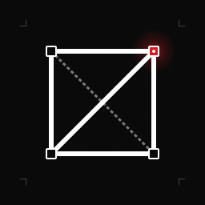
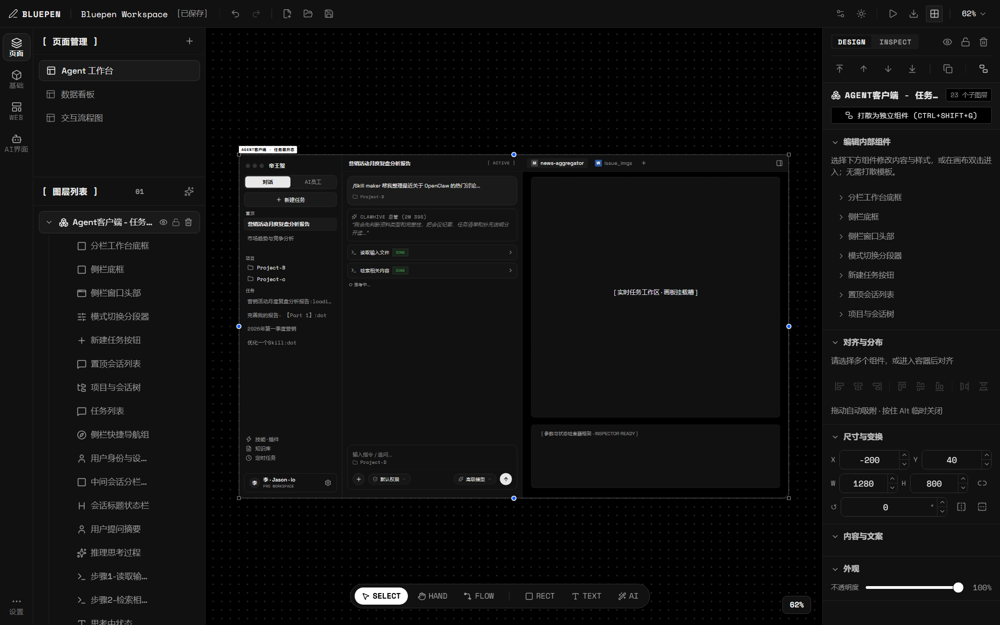
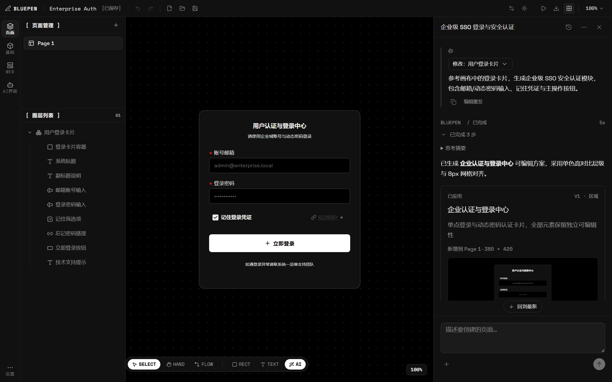
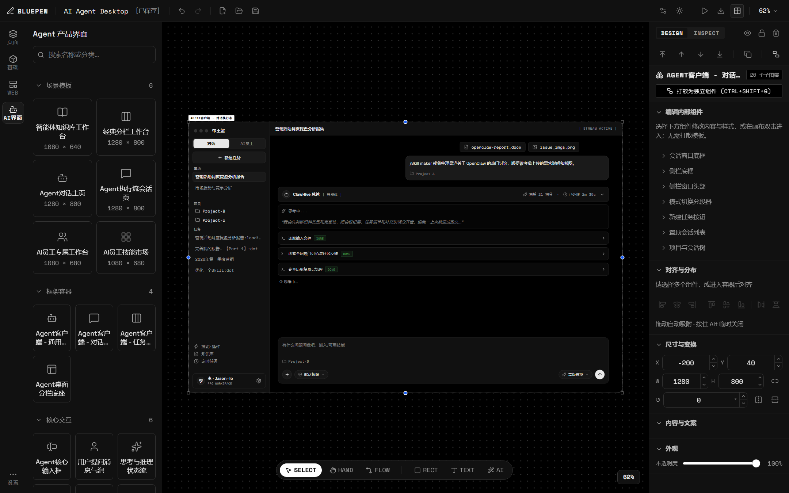
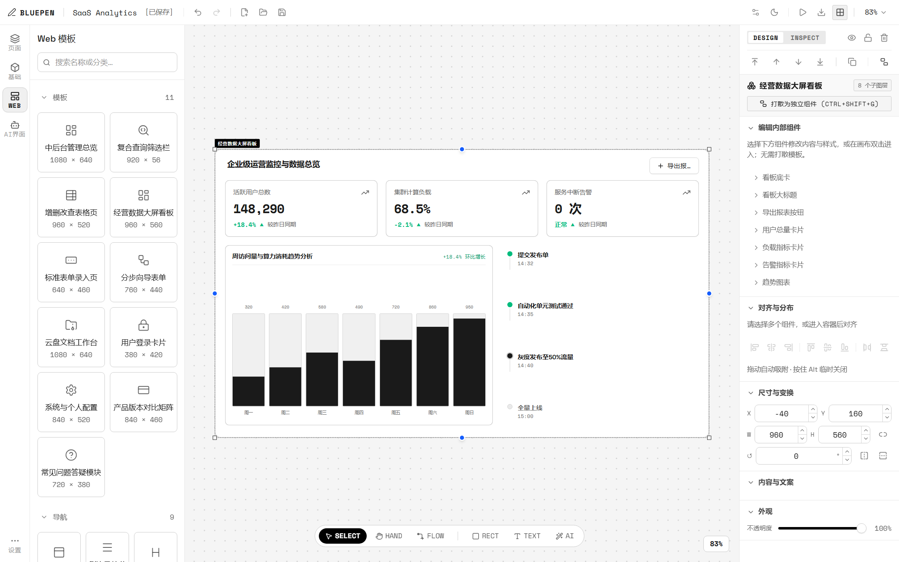
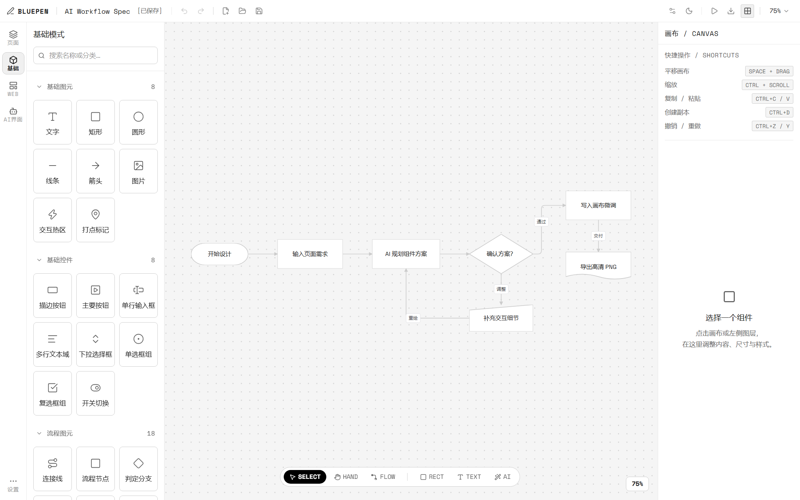
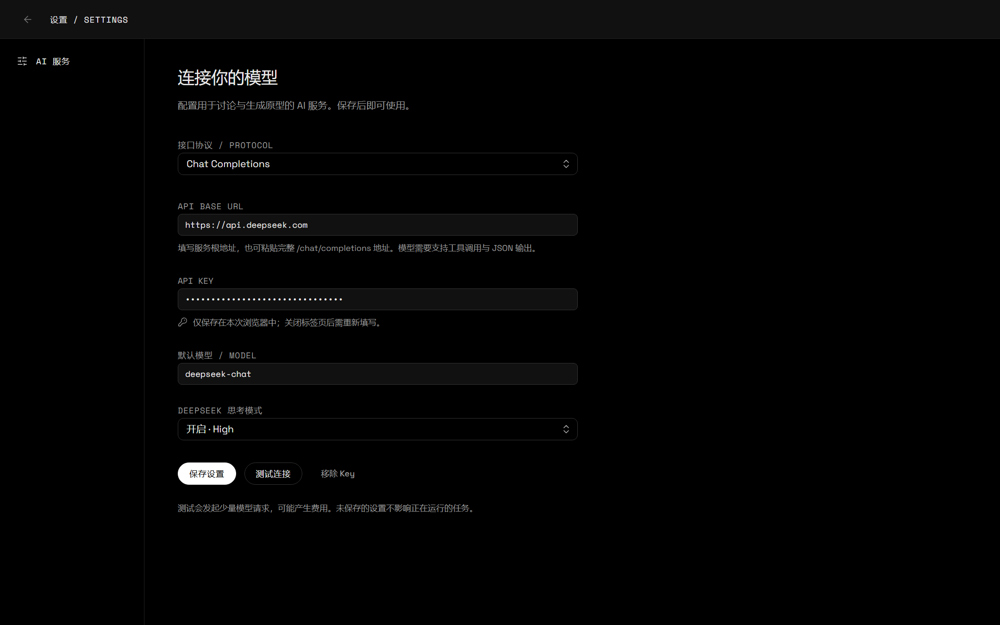

<div align="center">



<h1>Bluepen</h1>

<p>
  <b>AI-native, local-first prototyping for modern Web &amp; Agent interfaces.</b><br>
  Move from rough idea to structured wireframes, flows, and AI-assisted prototypes before a single pixel is polished.
</p>

<p>
  <a href="README.md">简体中文</a> · <b>English</b>
</p>

<p>
  <a href="https://github.com/mailwmj/Bluepen/releases"></a>
  <a href="LICENSE"></a>
  
  
</p>

<p>
  <a href="#highlights">Highlights</a> ·
  <a href="#visual-tour">Visual Tour</a> ·
  <a href="#component-libraries">Component Libraries</a> ·
  <a href="#download--installation">Download</a> ·
  <a href="#quick-start--shortcuts">Quick Start</a> ·
  <a href="#development--build">Development</a>
</p>

<br>

<picture>
  <source media="(prefers-color-scheme: dark)" srcset="docs/screenshots/hero-dark.png">
  <source media="(prefers-color-scheme: light)" srcset="docs/screenshots/hero-light.png">
  
</picture>

<sub><i>Bluepen desktop workspace — first-class Dark OLED &amp; Light technical-paper themes (auto-adapts to your GitHub color scheme)</i></sub>

</div>

---

## Highlights

- **AI-Native Prototyping Assistant (BYOK)** — Instead of generating flat images or opaque code, Bluepen's assistant queries the built-in component catalog and produces **structured, editable native canvas prototypes**. Reference selected canvas nodes, library components, or images, inspect the proposed plan first, apply with one click, and locate or undo anytime.
- **Purpose-Built for Web & Agent Interfaces (138 Built-in Components & Templates)** — Beyond wireframe primitives and flowcharts, Bluepen ships a dedicated **Agent Product UI Library** (split workspaces, execution stream chats, knowledge bases, AI employee markets, thought streams, tool steps) alongside full Web page templates — every template remains a live, editable tree of atomic components.
- **Fast, Local-First Cross-Platform Desktop App** — Built on **Tauri 2 + Rust** for fast startup and minimal footprint. Projects save as portable `.bluepen` files right on your machine with offline support and auto-recovery — no forced cloud lock-in.
- **Monochrome Industrial Precision** — Guided by an 8px dot-matrix grid and Nothing-inspired monochrome hierarchy in both Dark OLED and Light technical-paper themes, keeping focus squarely on structure, hierarchy, and interaction flow.

---

## Visual Tour

### 1. Built-in AI Assistant: Canvas References, Planned Proposals & One-Click Apply

Launch **AI Create / AI Modify** directly from the floating canvas toolbar or right-click menu, or work across multi-session threads in the side panel:

- **Targeted Context**: Attach selected canvas objects as modification targets or references, reference any library component with one click, or paste/upload reference images.
- **Transparent Execution**: Live reasoning summary, tool step timeline with durations, and clean structured responses.
- **Approve Before Writing**: Review a scalable visual preview of the generated prototype plan before committing it to the canvas — complete with one-click locate and instant undo.

<p align="center">
  
</p>

---

### 2. Dedicated Agent Product UI Library

Designed specifically for product managers and designers building AI-native software:

- **6 Complete Agent Workspace Templates**: Split Workspace, Agent Execution Stream Chat, Agent Home, Knowledge Base Workspace, AI Employee Workspace, and AI Employee Skill Market.
- **Specialized AI Interaction Primitives**: Reasoning/thought streams, tool execution step cards, prompt composers & toolbars, model badges, project/session trees, and artifact tabs.
- **Fully Editable Structure**: Modify any inner child directly from the inspector without ungrouping, or ungroup (`Ctrl/Cmd + Shift + G`) for complete custom recombination.

<p align="center">
  
</p>

---

### 3. Web Business Templates & Light Technical-Paper Mode

Includes **64 Web components and page templates** (Admin Overview, Analytics Dashboard, Cloud File Manager, CRUD Tables, Multi-Step Forms, Pricing Matrix, Auth Cards, and more). Switch seamlessly between Dark OLED and Light technical-paper modes for focused creation or clean spec reviews.

<p align="center">
  
</p>

---

### 4. Precision Infinite Canvas & Smart Flowcharts

Combine UI wireframes and user/system flowcharts across multiple pages in a single `.bluepen` project:

- **18 Flowchart Primitives & Orthogonal Connectors**: Live anchor snapping, draggable segment control points, and inline connector labels.
- **Precision Layout Tools**: Dot-matrix grid, smart alignment guides & equal-spacing snapping, grouping, and pixel-accurate arrow-key nudge/resize (`1px` / `10px`).
- **Present & Hand Off**: Built-in prototype preview mode (`Esc` to exit) and high-resolution **WYSIWYG PNG export**.

<p align="center">
  
</p>

---

### 5. Bring Your Own Model Key (BYOK): OpenAI & DeepSeek Ready

Connect your preferred LLM provider directly from in-app Settings with credentials stored locally on your machine:

- **Dual Protocol Support**: Works with both `Responses` and `Chat Completions` endpoints, with custom `API Base URL` and model names.
- **DeepSeek Thinking Mode**: Native DeepSeek reasoning mode selector (`Default` / `High` / `Off`) when using DeepSeek models.
- **Built-in Connection Check**: One-click test verifies tool calling and structured output compatibility before you start designing.

<p align="center">
  
</p>

---

## Component Libraries

Bluepen ships **3 curated libraries totaling 138 components & page templates**, all searchable and ready to click-insert or drag onto the canvas:

| Library | Count | What's Included |
| :--- | :---: | :--- |
| **Basic Mode** | **46** | Wireframe primitives (text, shapes, lines, arrows, image, hotspots, pins), basic controls, 18 flowchart shapes & smart connectors, browser/mobile frames |
| **Web Templates** | **64** | 11 full page templates (admin, dashboard, file manager, CRUD table, forms, login, pricing, FAQ), navigation, forms, data display, and feedback overlays |
| **Agent Product UI** | **28** | 6 full AI Agent desktop templates, shells & split panes, sidebars & session trees, prompt boxes, thought streams, tool steps, knowledge files & employee cards |

---

## Download & Installation

Grab the latest desktop installer from [**GitHub Releases**](https://github.com/mailwmj/Bluepen/releases/latest):

| Platform | Installer | Notes |
| :--- | :--- | :--- |
| **macOS** | `.dmg` | Recommended; bundles are currently ad-hoc signed — on first launch, allow via **System Settings → Privacy & Security** if prompted |
| **Windows** | NSIS `.exe` | Run the installer directly |
| **Linux** | `.deb` / `.rpm` | Available via on-demand GitHub Actions builds or local source builds below |

---

## Quick Start & Shortcuts

### Get Started in 3 Steps

1. **Drop a Structure**: Pick a full-page template from **Web Templates** or **Agent Product UI**, then press `Shift + 1` to fit the canvas.
2. **Collaborate with AI** *(optional)*: Open **Settings** (bottom-left), enter your OpenAI or DeepSeek-compatible API key, run **Test Connection**, and click **AI** in the bottom toolbar to generate or modify elements in place.
3. **Save or Export**: Press `Ctrl/Cmd + S` to save as a local `.bluepen` file, preview interactively, or export crisp PNGs from the top bar.

### Keyboard Shortcuts

> On macOS, replace `Ctrl` with `⌘` (Command).

| Category | Shortcut | Action |
| :--- | :--- | :--- |
| **File & View** | `Ctrl + N` / `Ctrl + O` / `Ctrl + S` / `Ctrl + Shift + S` | New / Open / Save / Save As `.bluepen` |
| | `Ctrl + B` | Toggle left sidebar drawer |
| | `Shift + 1` / `Shift + 2` | Zoom to fit all content / fit selection |
| | `Ctrl + =` / `Ctrl + -` / `Ctrl + 0` | Zoom in / zoom out / reset to 100% |
| | `Space + Drag` | Pan canvas |
| **Editing** | `Ctrl + Z` / `Ctrl + Shift + Z` (or `Ctrl + Y`) | Undo / Redo |
| | `Ctrl + C` / `Ctrl + X` / `Ctrl + V` / `Ctrl + D` | Copy / Cut / Paste / Duplicate |
| | `Ctrl + G` / `Ctrl + Shift + G` | Group / Ungroup selection |
| | `Ctrl + ]` / `Ctrl + [` *(+ `Shift`)* | Bring forward / send backward *(to front / back)* |
| | `Ctrl + L` | Lock / Unlock selection |
| **Precision Nudge** | `↑` `↓` `←` `→` *(+ `Shift`)* | Nudge position by `1px` *(`10px` with `Shift`)* |
| | `Alt + ↑ ↓ ← →` *(+ `Shift`)* | Resize by `1px` *(`10px` with `Shift`)* |
| **Preview** | `Esc` | Exit preview mode / clear selection |

---

## Tech Stack & Repository Layout

- **Desktop Runtime**: [Tauri 2](https://tauri.app) + Rust
- **Frontend**: [Next.js 16](https://nextjs.org) + [React 19](https://react.dev)
- **Styling & Primitives**: [Tailwind CSS v4](https://tailwindcss.com) + [Base UI](https://base-ui.com)
- **AI Layer**: [Vercel AI SDK](https://sdk.vercel.ai) + [Streamdown](https://github.com/vercel/streamdown) + Zod
- **Workspace**: [pnpm](https://pnpm.io) workspaces

```text
bluepen/
├── apps/
│   └── app/                  # Tauri 2 desktop shell + Next.js editor entry
│       └── src-tauri/        # Rust backend, window config, capabilities & icons
├── packages/
│   └── editor/               # Core editor: canvas, layers, inspector, 3 libraries, AI agent
├── docs/                     # Design docs and screenshot assets
└── .github/workflows/        # Cross-platform release build pipeline
```

---

## Development & Build

<details>
<summary><b>Expand: Prerequisites, local development, and packaging</b></summary>

### Prerequisites

- **Node.js** `20+` and **pnpm** `10+`
- **Rust** (stable) with the [Tauri 2 prerequisites](https://v2.tauri.app/start/prerequisites/)

Linux (Ubuntu / Debian):

```bash
sudo apt-get install -y libwebkit2gtk-4.1-dev libappindicator3-dev librsvg2-dev patchelf rpm
```

Linux (Fedora):

```bash
sudo dnf install webkit2gtk4.1-devel openssl-devel gcc gcc-c++ glib2-devel gtk3-devel libayatana-appindicator-gtk3-devel librsvg2-devel
```

### Run & Test Locally

```bash
# Install dependencies
pnpm install

# Start Tauri desktop app with hot reload
pnpm app:dev

# Run web editor dev server only
pnpm --filter app dev

# Run editor unit tests & workspace typecheck
pnpm test
pnpm typecheck
```

### Build a Local Installer Bundle

```bash
pnpm app:build
```

Bundles for your current OS are generated under `apps/app/src-tauri/target/release/bundle/`.

</details>

<details>
<summary><b>Expand: Publish cross-platform installers with GitHub Actions</b></summary>

Installers are built and published directly from the [Build Release](.github/workflows/release.yml) workflow:

1. Push the release commit to GitHub.
2. Go to **Actions** → **Build Release** → **Run workflow**.
3. Provide:
   - **tag**: `vMAJOR.MINOR.PATCH` (e.g. `v0.1.16`); installer versions are derived automatically.
   - **ref**: Git branch or commit SHA to build (default: `main`).
   - **release_notes**: User-facing Chinese release summary (used in the Release's **更新说明** section).
   - **targets**: Comma-separated list from `macos`, `windows`, `linux` (default: `macos,windows`).
4. Wait for the matrix jobs to complete. Successful runs publish or update the GitHub Release; failed runs retain built bundles as workflow artifacts for 7 days.

</details>

---

## Contributing & License

- Issues, feature requests, and pull requests are welcome on [GitHub Issues](https://github.com/mailwmj/Bluepen/issues).
- Please follow [CODE_OF_CONDUCT.md](CODE_OF_CONDUCT.md) and report security vulnerabilities privately via [SECURITY.md](SECURITY.md).
- Licensed under the [GNU Affero General Public License v3.0 (AGPL-3.0)](LICENSE) — © 2026 Bluepen.
