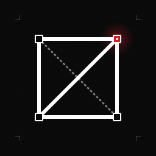
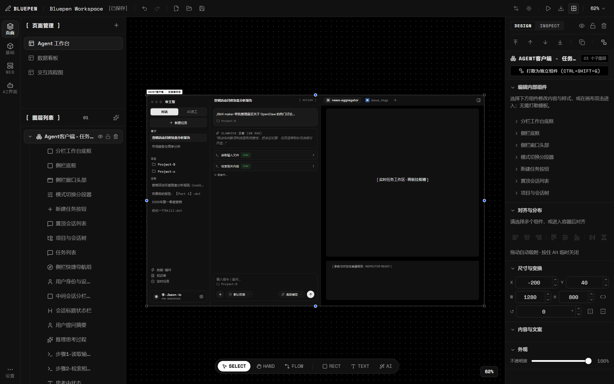
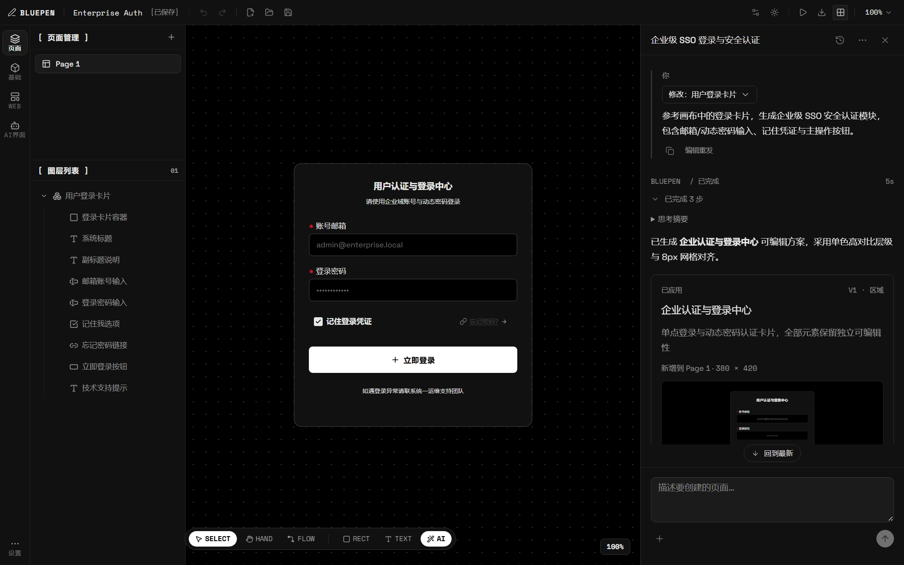
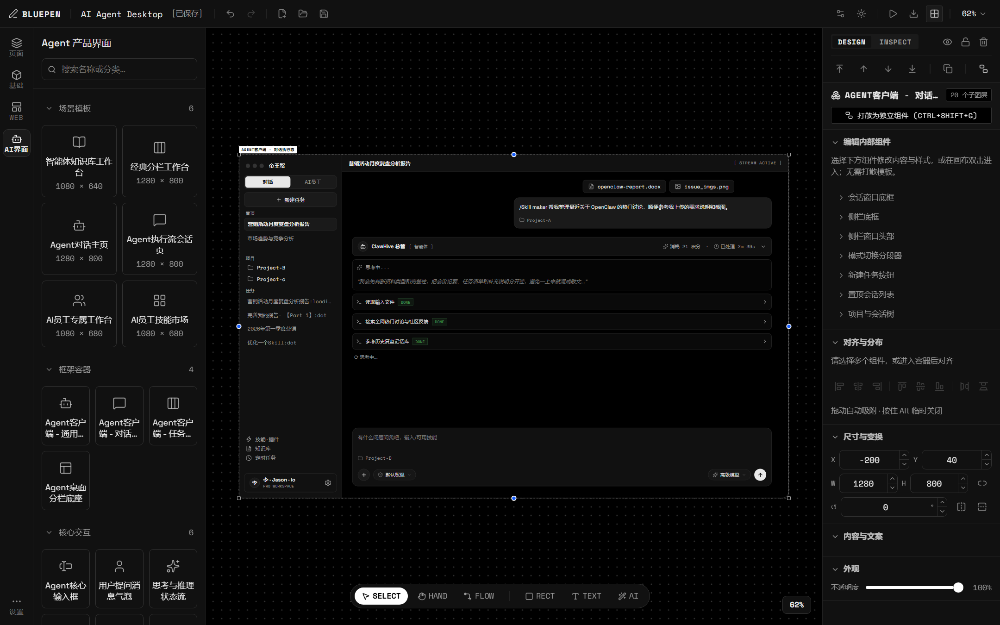
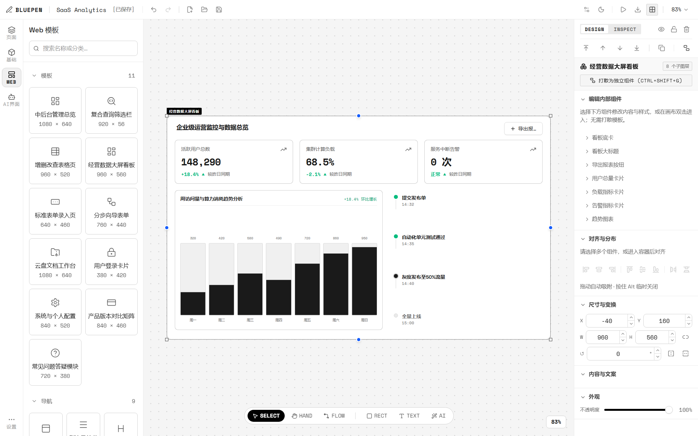
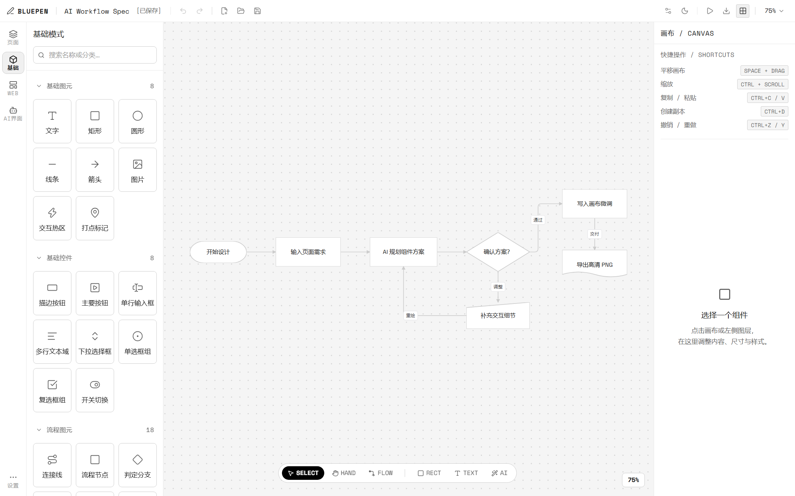
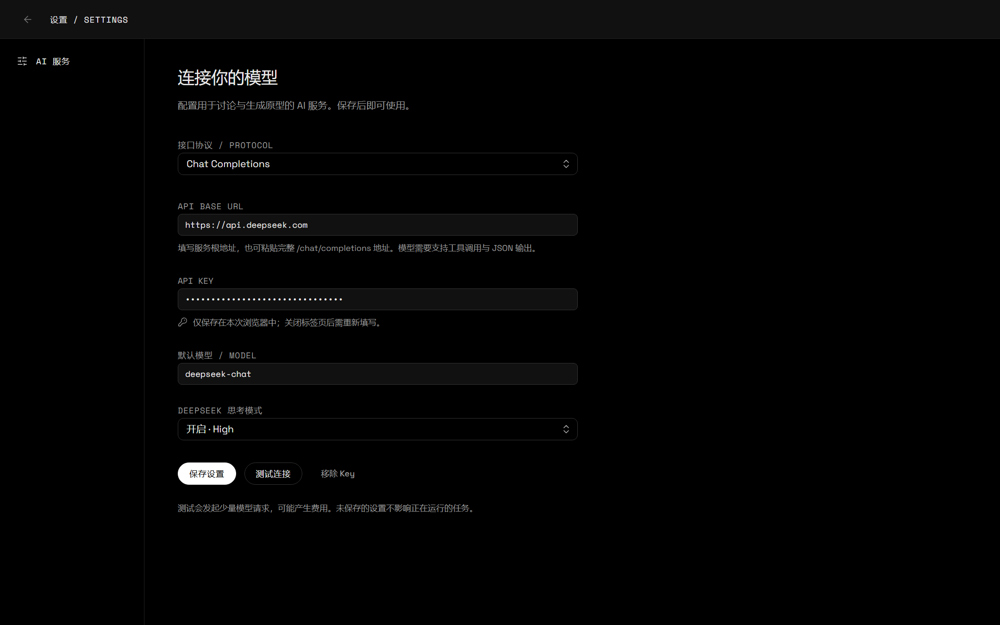

<div align="center">



<h1>Bluepen</h1>

<p>
  <b>面向 AI 时代的本地优先原型设计工具 — 为 Web 与 Agent 产品而生。</b><br>
  在像素精修之前，用结构化组件与原生 AI 助手快速完成信息架构、交互原型与流程推演。
</p>

<p>
  <b>简体中文</b> · <a href="README.en.md">English</a>
</p>

<p>
  <a href="https://github.com/mailwmj/Bluepen/releases"></a>
  <a href="LICENSE"></a>
  
  
</p>

<p>
  <a href="#核心特点">核心特点</a> ·
  <a href="#界面与场景一览">界面一览</a> ·
  <a href="#组件库全景">组件库</a> ·
  <a href="#下载与安装">下载安装</a> ·
  <a href="#快速上手与快捷键">快速上手</a> ·
  <a href="#本地开发与构建">开发指南</a>
</p>

<br>

<picture>
  <source media="(prefers-color-scheme: dark)" srcset="docs/screenshots/hero-dark.png">
  <source media="(prefers-color-scheme: light)" srcset="docs/screenshots/hero-light.png">
  
</picture>

<sub><i>Bluepen 工作台实景 — 支持深色 OLED 与浅色技术图纸双主题（根据当前 GitHub 主题自动切换预览）</i></sub>

</div>

---

## 核心特点

- **原生 AI 原型助手（BYOK）** — 不生成无法修改的静态图片或黑盒代码，而是检索内置组件库输出**结构化、可继续手工编辑的原生画布组件**；支持引用画布对象、组件库条目与参考图，先审方案再一键写入画布，随时定位与撤销。
- **专精 Web 与 Agent 产品界面（138 个内置组件与模板）** — 除基础线框与流程图元外，专门打造 **Agent 产品界面组件库**（分栏工作台、执行流会话页、知识库、AI 员工市场、思考状态流、工具步骤等）与完整 Web 业务模板，拖入画布即可直接调整内部每一个原子组件。
- **极速、本地优先的跨平台桌面端** — 基于 **Tauri 2 + Rust** 原生桌面架构构建，启动迅速、资源占用极低；项目以单文件 `.bluepen` 保存在本机，支持离线工作与自动恢复，无强制云端绑定。
- **单色工业设计美学** — 遵循极简单色与 8px 网格规范，深色 OLED 与浅色技术图纸双主题均为一等公民，减少色彩干扰，让团队聚焦页面结构、层级与交互逻辑本身。

---

## 界面与场景一览

### 1. 内置 AI 原型助手：引用画布、分步规划、确认写入

在画布底部工具栏或右键菜单即可随时唤起 **AI 创建 / AI 修改**，也可以展开右侧任务面板进行多会话协作：

- **精准上下文引用**：直接选中画布元素作为修改目标或参考，也可在组件库中一键将任意组件设为 AI 参考，或上传/粘贴参考截图。
- **透明执行过程**：流式展示思考摘要、工具调用步骤、各阶段耗时与清晰的结构化回复。
- **先确认、再落盘**：生成结果以可放大预览的方案卡片呈现，确认后才写入目标页面；写入后保留完整组件树，支持一键「定位到画布」与随时撤销。

<p align="center">
  
</p>

---

### 2. Agent 产品界面专库：面向 AI 应用的原生原型资产

为 AI 产品经理与设计师量身定制的 **Agent 产品界面库**，开箱即用：

- 内置 **6 套高完整度 Agent 场景模板**：经典分栏工作台、Agent 执行流会话页、Agent 对话主页、智能体知识库工作台、AI 员工专属工作台、AI 员工技能市场。
- 涵盖思考与推理状态流、工具调用步骤卡片、提示词输入框与工具栏、模型徽标、项目与会话树等专属交互组件。
- 所有复合模板均由原生原子组件组合而成，无需打散即可在右侧检视器直接修改内部任意子元素，也可按 `Ctrl/Cmd + Shift + G` 一键打散自由重组。

<p align="center">
  
</p>

---

### 3. Web 业务模板与浅色技术图纸模式

内置 **64 个 Web 组件与业务整页模板**（中后台管理总览、经营数据大屏看板、云盘文档工作台、增删改查表格、分步向导表单、产品定价矩阵、登录认证卡片等），一键切换深色 OLED / 浅色技术图纸模式，兼顾沉浸式搭建与清晰文档评审。

<p align="center">
  
</p>

---

### 4. 精密无限画布与智能流程图

在同一份项目文件中，用多页面同时串联产品界面与业务逻辑：

- **18 种标准流程图元与正交智能连线**：锚点自动吸附、支持拖拽控制点调整折线路径与在线编辑连线标注文字。
- **精密布局辅助**：点阵网格、智能对齐吸附与等距分布、成组/解组、像素级方向键微调（`1px` / `10px` 移动与缩放）。
- **演示与交付**：内置原型预览模式（`Esc` 退出）与所见即所得的高清 **PNG 导出**。

<p align="center">
  
</p>

---

### 5. 自带模型 Key（BYOK）：灵活接入 OpenAI / DeepSeek

在应用内「设置」页面配置你自己的大模型服务，所有凭据仅保存在本机：

- **双协议兼容**：支持 `Responses` 与 `Chat Completions` 两种接口协议，可自定义任意兼容服务商的 `API Base URL` 与模型名称。
- **DeepSeek 深度适配**：选择 DeepSeek 模型时原生提供思考模式开关（`服务默认` / `开启 · High` / `关闭`）。
- **一键连接验证**：内置「测试连接」能力，自动校验模型工具调用与结构化输出是否就绪。

<p align="center">
  
</p>

---

## 组件库全景

Bluepen 内置 **3 套独立组件库，共 138 个开箱即用的组件与整页模板**，均支持实时关键字检索与拖拽/点击插入：

| 组件库 | 数量 | 核心覆盖范围 |
| :--- | :---: | :--- |
| **基础模式** | **46** | 基础图元（文本/矩形/圆形/线条/箭头/图片/热区/打点）、基础控件、18 种标准流程图元与智能连线、桌面/移动端框架容器 |
| **Web 模板** | **64** | 11 套业务整页模板（管理后台、数据大屏、云盘工作台、CRUD 表格、表单、登录、定价、FAQ）、导航、表单、数据展示、消息反馈浮层 |
| **Agent 产品界面** | **28** | 6 套 AI Agent 客户端整页模板、框架容器、侧栏与会话树、提示词输入与参数栏、思考流/工具调用步骤、知识库与数字员工卡片 |

---

## 下载与安装

前往 [**GitHub Releases**](https://github.com/mailwmj/Bluepen/releases/latest) 获取最新版本的桌面端安装包：

| 平台 | 安装包格式 | 说明 |
| :--- | :--- | :--- |
| **macOS** | `.dmg` | 推荐下载；当前版本采用本地自签名（ad-hoc），首次打开如遇系统安全提示，可在「系统设置 → 隐私与安全性」中选择仍要打开 |
| **Windows** | NSIS `.exe` | 下载后直接运行安装向导 |
| **Linux** | `.deb` / `.rpm` | 支持通过 GitHub Actions 按需构建或参照下方指南从源码打包 |

---

## 快速上手与快捷键

### 三步开始原型设计

1. **搭建骨架**：在左侧切换「Web 模板」或「Agent 产品界面」，点击或拖入整页模板，按 `Shift + 1` 自动适配画布视野。
2. **AI 协作迭代**（可选）：点击左下角「设置」填写 OpenAI 或 DeepSeek 等兼容 API 信息并测试连接；随后点击底部工具栏 **AI** 按钮，即可引用画布元素让 AI 协助创建或修改原型。
3. **保存与交付**：按 `Ctrl/Cmd + S` 将项目保存为本地 `.bluepen` 文件，或点击顶部工具栏按钮进入「原型预览」与「导出高清 PNG」。

### 常用快捷键

> macOS 用户请将下表中的 `Ctrl` 替换为 `⌘`（Command）。

| 分类 | 快捷键 | 功能说明 |
| :--- | :--- | :--- |
| **文件与视图** | `Ctrl + N` / `Ctrl + O` / `Ctrl + S` / `Ctrl + Shift + S` | 新建 / 打开 / 保存 / 另存为 `.bluepen` 项目 |
| | `Ctrl + B` | 展开 / 收起左侧组件与图层抽屉 |
| | `Shift + 1` / `Shift + 2` | 缩放至适应全部内容 / 适应当前选中对象 |
| | `Ctrl + =` / `Ctrl + -` / `Ctrl + 0` | 放大 / 缩小 / 重置为 100% |
| | `Space + 拖拽` | 平移画布 |
| **编辑与编排** | `Ctrl + Z` / `Ctrl + Shift + Z`（或 `Ctrl + Y`） | 撤销 / 重做 |
| | `Ctrl + C` / `Ctrl + X` / `Ctrl + V` / `Ctrl + D` | 复制 / 剪切 / 粘贴 / 创建副本 |
| | `Ctrl + G` / `Ctrl + Shift + G` | 组合选中元素 / 打散组合 |
| | `Ctrl + ]` / `Ctrl + [`（配合 `Shift`） | 上移 / 下移图层（置顶 / 置底） |
| | `Ctrl + L` | 锁定 / 解锁选中元素 |
| **像素级微调** | `↑` `↓` `←` `→`（配合 `Shift`） | 移动 `1px`（配合 `Shift` 为 `10px`） |
| | `Alt + ↑ ↓ ← →`（配合 `Shift`） | 调整尺寸 `1px`（配合 `Shift` 为 `10px`） |
| **预览与取消** | `Esc` | 退出原型预览模式 / 取消当前选择 |

---

## 技术栈与仓库结构

- **桌面端内核**：[Tauri 2](https://tauri.app) + Rust
- **前端界面**：[Next.js 16](https://nextjs.org) + [React 19](https://react.dev)
- **样式与组件原语**：[Tailwind CSS v4](https://tailwindcss.com) + [Base UI](https://base-ui.com)
- **AI 能力层**：[Vercel AI SDK](https://sdk.vercel.ai) + [Streamdown](https://github.com/vercel/streamdown) + Zod
- **Monorepo 管理**：[pnpm](https://pnpm.io) workspaces

```text
bluepen/
├── apps/
│   └── app/                  # Tauri 2 桌面端外壳 + Next.js 编辑器入口
│       └── src-tauri/        # Rust 后端、窗口配置、系统权限与图标资源
├── packages/
│   └── editor/               # 核心编辑器包：无限画布、图层树、检视器、三大组件库、AI 助手
├── docs/                     # 设计文档与界面截图资源
└── .github/workflows/        # 跨平台自动化构建与 Release 发布流水线
```

---

## 本地开发与构建

<details>
<summary><b>展开查看：环境要求、本地运行与打包命令</b></summary>

### 前置要求

- **Node.js** `20+` 与 **pnpm** `10+`
- **Rust**（stable 工具链）及对应平台的 [Tauri 2 构建依赖](https://v2.tauri.app/start/prerequisites/)

Linux（Ubuntu / Debian）参考依赖：

```bash
sudo apt-get install -y libwebkit2gtk-4.1-dev libappindicator3-dev librsvg2-dev patchelf rpm
```

Linux（Fedora）参考依赖：

```bash
sudo dnf install webkit2gtk4.1-devel openssl-devel gcc gcc-c++ glib2-devel gtk3-devel libayatana-appindicator-gtk3-devel librsvg2-devel
```

### 本地开发与测试

```bash
# 安装全部依赖
pnpm install

# 启动 Tauri 桌面端开发模式（支持热重载）
pnpm app:dev

# 仅启动 Web 前端开发服务器
pnpm --filter app dev

# 运行编辑器单元测试与全仓库类型检查
pnpm test
pnpm typecheck
```

### 构建本地安装包

```bash
pnpm app:build
```

该命令会为当前系统构建原生安装包，产物位于 `apps/app/src-tauri/target/release/bundle/`。

</details>

<details>
<summary><b>展开查看：通过 GitHub Actions 发布跨平台安装包</b></summary>

安装包直接由本仓库的 [Build Release](.github/workflows/release.yml) 工作流构建并发布至 GitHub Releases：

1. 将待发布代码推送到 GitHub。
2. 打开仓库的 **Actions** → **Build Release** → **Run workflow**。
3. 填写以下参数：
   - **tag**：遵循 `vMAJOR.MINOR.PATCH` 格式（例如 `v0.1.16`），工作流会自动同步安装包版本号。
   - **ref**：要构建的分支名或 Commit SHA（默认 `main`）。
   - **release_notes**：面向用户的中文更新说明（将自动写入 Release 的「更新说明」章节）。
   - **targets**：逗号分隔的目标平台，可选 `macos`、`windows`、`linux`（默认 `macos,windows`）。
4. 等待各平台构建完成，成功后将自动创建或更新对应的 GitHub Release；若某平台失败，其余产物也会作为 Workflow Artifact 保留 7 天以便排查。

</details>

---

## 参与贡献与协议

- 欢迎提交 [Issue](https://github.com/mailwmj/Bluepen/issues) 反馈问题或提出新组件/模板建议，也欢迎直接提交 Pull Request。
- 社区行为准则请参阅 [CODE_OF_CONDUCT.md](CODE_OF_CONDUCT.md)，安全漏洞请按 [SECURITY.md](SECURITY.md) 私密上报。
- 本项目基于 [MIT License](LICENSE) 开源 — © 2026 Bluepen.
